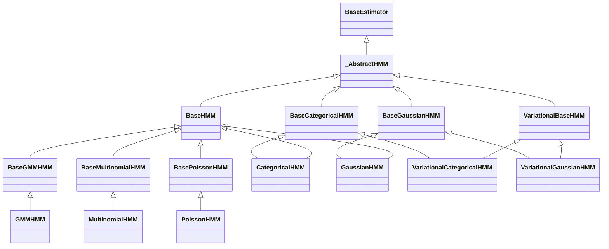
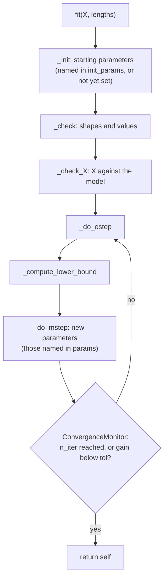

# How hmm-craft is built

This file describes the package from the Python API down to the C++ kernel,
what the package promises about its fits, and how a change to a fit is made.
It is written from the code in this repository; the code wins where the two
disagree.

## Layout

| Path | Holds |
|---|---|
| `src/hmmcraft/base.py` | `ConvergenceMonitor`, `_AbstractHMM` (the public methods and the fit loop), `BaseHMM` (expectation-maximization), `VariationalBaseHMM` (variational inference) |
| `src/hmmcraft/_emissions.py` | one base class per emission family: how to compute the emission probabilities, collect the statistics an M-step needs, and draw a sample |
| `src/hmmcraft/hmm.py` | the five EM models: `CategoricalHMM`, `GaussianHMM`, `GMMHMM`, `MultinomialHMM`, `PoissonHMM` |
| `src/hmmcraft/vhmm.py` | the two variational models: `VariationalCategoricalHMM`, `VariationalGaussianHMM` |
| `src/hmmcraft/utils.py` | public helpers: `normalize`, `log_normalize`, `fill_covars` |
| `src/hmmcraft/stats.py` | `log_multivariate_normal_density` for the four covariance types |
| `src/hmmcraft/_utils.py`, `_kl_divergence.py` | private helpers; the KL divergences of the variational lower bound |
| `ext/_hmmc.cpp` | the C++ kernel, built by `setup.py` with pybind11 as `hmmcraft._hmmc` |
| `src/hmmcraft/tests/` | the suite, installed with the package |
| `scripts/` | the bit-equality check and the CI helpers; not installed |

## Classes

`BaseEstimator` is scikit-learn's: it gives `get_params`, `set_params` and
cloning. A public model combines two halves. The emission half (a class of
`_emissions.py`) knows the distribution of one observation in one state. The
learning half (`BaseHMM` or `VariationalBaseHMM`) knows how the start
probabilities and the transition matrix are estimated. Categorical and
Gaussian emissions exist in both halves, so their emission classes derive
from `_AbstractHMM` and are combined with a learning class; the other three
emission classes derive from `BaseHMM` directly.

## The fit loop

`_AbstractHMM.fit(X, lengths)` is the only fit loop. `X` holds every
sequence, one after another; `lengths` gives the length of each, a positive
integer. `fit` first refuses an `n_components` less than 1, then passes `X`
and `lengths` to `_utils.split_X_lengths`, which raises `ValueError` for any
other entry and for a total that is not the number of samples, so no start is
computed from invalid `lengths`. After `_init` and `_check`, and before the
first E-step, `_check_X` checks `X` against the model.

`_do_estep` splits `X` by `lengths` and, for each sequence:

1. computes the emission probability of every sample in every state
   (`_compute_likelihood`, or `_compute_log_likelihood` when
   `implementation="log"`, the default);
2. calls the kernel's forward and backward passes on that matrix with
   `startprob_` and `transmat_`, and turns the two lattices into the
   posterior probability of each state at each sample;
3. adds what the M-step needs to a dictionary of statistics
   (`_accumulate_sufficient_statistics`); for the transitions, the kernel
   computes the expected transition counts (`compute_log_xi_sum` or
   `compute_scaling_xi_sum`).

It also sums the posteriors into `state_occupancy_`, the expected number of
samples in each state. `BaseHMM` returns the summed log-likelihood as the
lower bound; `VariationalBaseHMM` subtracts the KL divergences of its
posteriors from their priors, and runs the passes on subnormalized
probabilities (`_estep_begin`).

A model class supplies these hooks; the loop never changes per class:

| Hook | Does |
|---|---|
| `_init` | sets the starting parameters named in `init_params`, and any that is not yet set (k-means for Gaussian means, for instance) |
| `_check` | validates shapes (`GaussianHMM`'s `means_` among them); in the five expectation-maximization models, also that probabilities sum to one with no negative entry and that emission parameters are finite |
| `_check_X` | checks `X` against the model after `_check`, reading only: its number of columns, or for the categorical models that each symbol is a whole number from 0 to `n_features - 1` and that `X` is not boolean; then, for the multinomial and Poisson models, that each count is a non-negative whole number. The base class checks nothing, so a model that brings its own likelihood takes `X` as it is |
| `_compute_likelihood` / `_compute_log_likelihood` | at least one implemented; the base class derives a missing one from the other |
| `_initialize_sufficient_statistics` | the empty dictionary of statistics |
| `_accumulate_sufficient_statistics` | adds one sequence's statistics |
| `_do_mstep` | sets the parameters named in `params` from the statistics |
| `_generate_sample_from_state` | draws one observation, for `sample` |
| `_get_n_fit_scalars_per_param` | the free parameters, for the warning on too little data and for `aic` and `bic` |
| `_n_features_from_emissions` | the number of features the emission parameter implies (`means_`, `means_posterior_`, `emissionprob_` or `lambdas_`) |

`n_features` is set from `X` by `fit`, or from the emission parameter by
`_check`. `_get_n_features` returns it, or before either has run the count the
emission parameter implies; `aic`, `bic` and a spherical `covars_` read it
there. `_check_X` compares the columns of `X` with the count the emission
parameter implies, not with `n_features`, which an earlier fit may have left;
the categorical models, whose `n_features` is a constructor parameter and
whose `X` holds symbols, test the symbols against `_get_n_features`.
`implementation` is read through `_by_implementation`, which raises
`ValueError` for a value other than `"log"` or `"scaling"`.

`score` runs the forward pass alone; `score_samples`, `predict_proba` and
`decode(algorithm="map")` run the forward and backward passes; none of them
fits. Each, and `decode`, runs `_check` and then `_check_X` on `X` before
it is split into sequences. `decode` with `algorithm="viterbi"` calls the
kernel's `viterbi`. `sample` is a Python loop over the transition matrix and
`_generate_sample_from_state`; it refuses fewer than one sample.

## The C++ kernel

`ext/_hmmc.cpp` holds the recursions that loop over every sample and every
pair of states. It knows nothing about emissions: it receives the emission
probabilities (or log-probabilities) of one sequence as a matrix of shape
`(n_samples, n_components)`, already computed in Python. Every argument is a
float64 array.

| Function | Takes | Returns |
|---|---|---|
| `forward_log` | start probabilities, transition matrix, emission log-probabilities | the log-likelihood and the forward lattice, in log space |
| `backward_log` | the same | the backward lattice, in log space |
| `forward_scaling` | start probabilities, transition matrix, emission probabilities | the log-likelihood, the forward lattice and the scaling factor of each sample |
| `backward_scaling` | the same, and the scaling factors | the backward lattice, scaled with those factors |
| `compute_log_xi_sum` | forward lattice, transition matrix, backward lattice, emission log-probabilities | the expected transition counts, in log space |
| `compute_scaling_xi_sum` | forward lattice, transition matrix, backward lattice, emission probabilities | the expected transition counts |
| `viterbi` | start probabilities, transition matrix, emission log-probabilities | the log-probability of the best path and the path |

A shape that does not match raises `ValueError`, and so does a matrix with no
rows (a sequence without samples) or no columns (a model without states): the
recursions use unchecked accessors, and hmmlearn 0.3.3's kernel indexed
outside its arrays there. Each function releases the GIL while it loops. The
kernel's source is hmmlearn 0.3.3's apart from that check and the module's
package name.

## What the package promises

**Fits are checked to equal hmmlearn 0.3.3's, bit for bit, apart from the
differences listed in `DIFFERENCES.md`.** `scripts/bit_equality.py` fits every
model class, covariance type and implementation with both packages, in two
environments with the same versions, on synthetic data generated inside the
script from a fixed seed, with one thread, and compares every fitted array,
the log-likelihood, both decodes and a drawn sample as bytes, not within a
tolerance. `DIFFERENCES.md` names the data, the versions, the platform and the
result; the claim covers that check and nothing beyond it. Both CI cells
(`ci.yml`) run it on every pull request and every week, each with the
reference installed at the same versions as the package.

### Step 1 and step 2

The fork changes fits in two steps.

**Step 1** is the fork as first published: hmmlearn 0.3.3 under a new name,
with newer minimum versions, wheels, CI, and the changes listed in
`DIFFERENCES.md`. Two of them change a fit with every option at its default.
One replaces a result that hmmlearn 0.3.3 computed wrongly or failed to
compute (the Gaussian fit of covariances without means). The other makes
repeatable a result that hmmlearn 0.3.3 left to memory placement on CPUs
with AVX-512 and numpy before 2.0.2: the log-determinant of the `full` and
`tied` log-densities is taken in place on a contiguous copy, which, as read
from numpy's code, always gets numpy's vector loop there, whatever the
allocator; its last bits can then differ from 0.3.3's.
`GaussianHMM(covars_floor=...)` changes fits only when it is set. In the check
above, every other fit equals 0.3.3's.

**Step 2** holds the later changes that move a fit hmmlearn 0.3.3 computes
correctly and repeatably. Each one comes behind an option whose default keeps 0.3.3's result,
is listed in `DIFFERENCES.md` with an exception of its own in the check, is
named in `CHANGES.rst`, and ships in a minor release (`RELEASING.md`).
Equality is always checked against hmmlearn 0.3.3, with every option at its
default.
