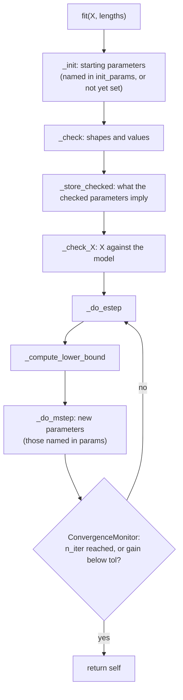

# How hmm-craft is built

This file describes the package from the Python API down to the C++ kernel,
what the package promises about its fits, and how a change to a fit is made.
It is written from the code in this repository; the code wins where the two
disagree.

## Layout

| Path | Holds |
|---|---|
| `src/hmmcraft/base.py` | `ConvergenceMonitor`, `_AbstractHMM` (the public methods and the fit loop), `BaseHMM` (expectation-maximization), `VariationalBaseHMM` (variational inference) |
| `src/hmmcraft/_emissions.py` | one base class per emission family: how to compute the emission probabilities, collect the statistics an M-step needs, and draw a sample |
| `src/hmmcraft/hmm.py` | the five EM models: `CategoricalHMM`, `GaussianHMM`, `GMMHMM`, `MultinomialHMM`, `PoissonHMM` |
| `src/hmmcraft/vhmm.py` | the two variational models: `VariationalCategoricalHMM`, `VariationalGaussianHMM` |
| `src/hmmcraft/utils.py` | public helpers: `normalize`, `log_normalize`, `fill_covars` |
| `src/hmmcraft/stats.py` | `log_multivariate_normal_density` for the four covariance types |
| `src/hmmcraft/_utils.py`, `_kl_divergence.py` | private helpers; the KL divergences of the variational lower bound |
| `ext/_hmmc.cpp` | the C++ kernel, built by `setup.py` with pybind11 as `hmmcraft._hmmc` |
| `ext/_emissionsc.cpp` | emission loops in C++, built by `setup.py` with pybind11 as `hmmcraft._emissionsc` |
| `src/hmmcraft/tests/` | the suite, installed with the package |
| `scripts/` | the bit-equality check and the CI helpers; not installed |

## Classes

`BaseEstimator` is scikit-learn's: it gives `get_params`, `set_params` and
cloning. A public model combines two halves. The emission half (a class of
`_emissions.py`) knows the distribution of one observation in one state. The
learning half (`BaseHMM` or `VariationalBaseHMM`) knows how the start
probabilities and the transition matrix are estimated. Categorical and
Gaussian emissions exist in both halves, so their emission classes derive
from `_AbstractHMM` and are combined with a learning class; the other three
emission classes derive from `BaseHMM` directly.

## The fit loop

`_AbstractHMM.fit(X, lengths)` is the only fit loop. `X` holds every
sequence, one after another; `lengths` gives the length of each, a positive
integer. `fit` first refuses an `n_components` less than 1, then passes `X`
and `lengths` to `_utils.split_X_lengths`, which raises `ValueError` for any
other entry and for a total that is not the number of samples, so no start is
computed from invalid `lengths`. After `_init`, `_check` and `_store_checked`,
and before the first E-step, `_check_X` checks `X` against the model.

`_do_estep` splits `X` by `lengths` and, for each sequence:

1. computes the emission probability of every sample in every state
   (`_compute_likelihood`, or `_compute_log_likelihood` when
   `implementation="log"`, the default);
2. calls the kernel's forward and backward passes on that matrix with
   `startprob_` and `transmat_`, and turns the two lattices into the
   posterior probability of each state at each sample;
3. adds what the M-step needs to a dictionary of statistics
   (`_accumulate_sufficient_statistics`); for the transitions, the kernel
   computes the expected transition counts (`compute_log_xi_sum` or
   `compute_scaling_xi_sum`).

It runs these steps in one of two ways, chosen at the start of each E-step.

Sequence by sequence (`_estep_sequence`): the three steps for the first
sequence, then for the second, with the per-sequence kernel functions. This
is hmmlearn 0.3.3's loop.

By blocks. Consecutive sequences form a block of at most
`_ESTEP_BLOCK_ROWS` rows (4096) and at most
`max(1, _ESTEP_BLOCK_ROWS // n_components)` sequences; a longer sequence is
a block alone. For a block, `_do_estep` first computes steps 1 and 2 for all
its sequences: the emission matrix of the stacked rows, one call of the
kernel's `estep_log` or `estep_scaling`, and the posteriors of all rows by
one call of `_compute_posteriors_log` or `_compute_posteriors_scaling`.
Then, sequence after sequence in `lengths` order, it adds that sequence's
posteriors to `state_occupancy_` and calls `_accumulate_sufficient_statistics`
with that sequence's rows of each matrix. Every statistic is therefore
summed per sequence, in the loop's order, and the transition counts are
still computed per sequence.

The emission matrix of a block comes from one call of the emission hook
where a row's values do not depend on the other rows of the call
(`_lattice_by_rows`): the categorical models; `GaussianHMM` with
`spherical` or `diag` covariances when `X`, the means and the variances
are float64 arrays in C order with at most `numpy.getbufsize()` features;
`PoissonHMM` and `MultinomialHMM` for the arrays their shorter forms
accept. Otherwise the hook is called once per sequence and fills that
sequence's rows, with `_estep_values` set as in the loop: `full` and
`tied`, `GMMHMM`, `VariationalGaussianHMM`, and every other input.

Blocks are used only when the E-step's methods are the model class's own.
Each of the seven model classes is marked as the owner of its E-step
(`_block_estep`); `_takes_blocks` reads every name of `_ESTEP_HOOKS` on the
instance and compares it with the owner's method. A subclass that replaces
one of them, or an instance that carries one as an attribute, is computed
sequence by sequence, so its methods are called in the same order as
before. So is a class without an owner, a model with more states than
`numpy.getbufsize()`, and a categorical model whose `X` has more than one
column. So are two models whose likelihood warns or raises at every call,
from their parameters alone: a `GMMHMM` with a zero mixture weight, when
the caller's error state asks for the report its logarithm gives, and a
`VariationalGaussianHMM` whose scale matrix is singular or has an inverse
with a negative determinant; `_takes_blocks` tests both without a report.

Steps 1 and 2 of a block run with every floating-point report the caller's
numpy error state asks for turned into an error. When one is raised,
nothing of the block is used and its sequences are computed sequence by
sequence in the caller's state, after the error has been handled, so
numpy's warnings, errors and handler calls are those of the loop.

With `implementation="scaling"`, the kernel's `forward_scaling` raises
`ValueError` when the probabilities of a sample sum to less than 1e-300 over
the states. `_do_estep` recognises that error by the start of its message
(`_SCALING_UNDERFLOW`), never by its type, which the kernel's shape and
empty-input errors share, and computes that sequence with the log functions
instead (`_fit_log`): its statistics are accumulated with the log accumulator,
selected by the private class attribute `_accumulate_as_log`, which
`_do_estep` sets on the instance for that one call and deletes after it. When
the log forward pass gives no finite log-likelihood either, the original error
is raised again before the backward pass. One warning is logged per E-step in
which a sequence fell back. The other sequences are computed as before, in
`lengths` order. In a block, `estep_scaling` flags such a sequence instead
of raising; `_do_estep` then calls `forward_scaling` on that sequence's
rows, which raises the error, and continues as above.

`_do_estep` also keeps the sequence it is computing in the private attribute
`_estep_values`, a list it sets on the instance before the sequence's first
hook and removes after its statistics, also when a hook raises. `GMMHMM` uses
it to compute its mixture densities once: `_compute_log_likelihood` adds each
state's weighted log-densities and their `logsumexp` to the list, and
`_accumulate_sufficient_statistics` reads them where hmmlearn 0.3.3 computes
them again. They are kept only when computing them again would give the same
values and report nothing: the hooks are the class's own, no floating-point
report the caller's numpy error state asks for was raised, every `logsumexp`
is finite, and the error state asks for the same reports when they are
read. When the densities are one mixture wide, nothing is kept but that
error state, with no test of the `logsumexp`, and the statistics write the
mixture posteriors as ones, the value hmmlearn 0.3.3 computes there. In
every other case, and outside `fit`, the statistics compute them again and
prediction sets nothing.

It also sums the posteriors into `state_occupancy_`, the expected number of
samples in each state. `BaseHMM` returns the summed log-likelihood as the
lower bound; `VariationalBaseHMM` subtracts the KL divergences of its
posteriors from their priors, and runs the passes on subnormalized
probabilities (`_estep_begin`).

A model class supplies these hooks; the loop never changes per class:

| Hook | Does |
|---|---|
| `_init` | sets the starting parameters named in `init_params`, and any that is not yet set (k-means for Gaussian means, for instance, run on one thread) |
| `_check` | validates shapes (`GaussianHMM`'s `means_` among them); in the five expectation-maximization models, also that probabilities sum to one with no negative entry and that emission parameters are finite, reading the model and writing nothing |
| `_store_checked` | called by `fit` alone, after `_check`: stores what the checked parameters imply (`GaussianHMM`: `n_features` from `means_`); the base class stores nothing |
| `_check_X` | checks `X` against the model after `_check`, reading only: its number of columns, or for the categorical models that each symbol is a whole number from 0 to `n_features - 1` and that `X` is not boolean; then, for the multinomial and Poisson models, that each count is a non-negative whole number. The base class checks nothing, so a model that brings its own likelihood takes `X` as it is |
| `_compute_likelihood` / `_compute_log_likelihood` | at least one implemented; the base class derives a missing one from the other |
| `_initialize_sufficient_statistics` | the empty dictionary of statistics |
| `_accumulate_sufficient_statistics` | adds one sequence's statistics |
| `_do_mstep` | sets the parameters named in `params` from the statistics |
| `_generate_sample_from_state` | draws one observation, for `sample` |
| `_get_n_fit_scalars_per_param` | the free parameters, for the warning on too little data and for `aic` and `bic` |
| `_n_features_from_emissions` | the number of features the emission parameter implies (`means_`, `means_posterior_`, `emissionprob_` or `lambdas_`) |

`n_features` is set by `fit` alone, from `X` (`GaussianHMM` stores the width
of `means_` in `_store_checked`); a prediction never sets it.
`_get_n_features` returns it, or when it is not set the count the emission
parameter implies; `aic`, `bic` and a spherical `covars_` read it there.
`GaussianHMM` reads the width of `means_` once a `means_` of a valid shape is
set, and `n_features` otherwise, so an `n_features` an earlier fit left is not
read.
`_check_X` compares the columns of `X` with the count the emission parameter
implies, not with `n_features`, which an earlier fit may have left; the
categorical models, whose `n_features` is a constructor parameter and whose
`X` holds symbols, test the symbols against `_get_n_features`.
`implementation` is read through `_by_implementation`, which raises
`ValueError` for a value other than `"log"` or `"scaling"`.

In the five expectation-maximization models a parameter is converted to an
array when it is assigned, by a data descriptor on the class
(`_ConvertedAttribute`): `startprob_` and `transmat_` (`np.asarray`), the
`emissionprob_` of `CategoricalHMM` and `MultinomialHMM` and the `lambdas_` of
`PoissonHMM` (`np.atleast_2d`), the `means_` of `GaussianHMM` (`np.asarray`),
and the `weights_`, `means_` and `covars_` of `GMMHMM` (`np.array`, a copy).
The value is kept in the instance's `__dict__` under the parameter's own name,
so `vars(model)` and a pickle hold what a plain attribute would.
`_AbstractHMM.__setstate__` assigns these parameters again, so a pickle that
holds one as a list loads it as an array. `_check` therefore only reads.

`score` runs the forward pass alone; `score_samples`, `predict_proba` and
`decode(algorithm="map")` run the forward and backward passes; none of them
fits. With `implementation="scaling"` they compute a sequence whose scaled
forward pass underflows with the log functions (`_score_log`), as the E-step
does, and log one warning per call; `decode` scores each sequence on its own,
so it logs one per such sequence. Each, and `decode`, runs `_check` and then
`_check_X` on `X` before it is split into sequences; in the five
expectation-maximization models neither writes to the model. `decode` with
`algorithm="viterbi"` calls the kernel's `viterbi`. `sample` is a Python loop
over the transition matrix and `_generate_sample_from_state`; it refuses fewer
than one sample.

## The C++ kernel

`ext/_hmmc.cpp` holds the recursions that loop over every sample and every
pair of states. It knows nothing about emissions: it receives the emission
probabilities (or log-probabilities) of one sequence as a matrix of shape
`(n_samples, n_components)` (the two block functions below take the matrices
of several sequences stacked), already computed by the emission code (in
numpy, or for some inputs by the emission loops below). Every argument is a
float64 array, apart from the block functions' lengths (integers) and their
choice of transition counts (a boolean).

| Function | Takes | Returns |
|---|---|---|
| `forward_log` | start probabilities, transition matrix, emission log-probabilities | the log-likelihood and the forward lattice, in log space |
| `backward_log` | the same | the backward lattice, in log space |
| `forward_scaling` | start probabilities, transition matrix, emission probabilities | the log-likelihood, the forward lattice and the scaling factor of each sample |
| `backward_scaling` | the same, and the scaling factors | the backward lattice, scaled with those factors |
| `compute_log_xi_sum` | forward lattice, transition matrix, backward lattice, emission log-probabilities | the expected transition counts, in log space |
| `compute_scaling_xi_sum` | forward lattice, transition matrix, backward lattice, emission probabilities | the expected transition counts |
| `viterbi` | start probabilities, transition matrix, emission log-probabilities | the log-probability of the best path and the path |
| `estep_log` | start probabilities, transition matrix, the emission log-probabilities of several sequences stacked in one matrix, the number of rows of each sequence, whether the transition counts are wanted | for each sequence what `forward_log`, `backward_log` and `compute_log_xi_sum` return: the log-likelihoods, the stacked forward and backward lattices, and one matrix of expected transition counts per sequence, in log space |
| `estep_scaling` | the same, with emission probabilities | the same from the three scaling functions, and one flag per sequence |

`forward_scaling` raises `ValueError` when the probabilities of a sample sum
to less than 1e-300 over the states, with a message that starts "forward pass
failed with underflow", as hmmlearn 0.3.3's does. A shape that does not match
raises `ValueError`, and so does a matrix with no rows (a sequence without
samples) or no columns (a model without states): the recursions use unchecked
accessors, and hmmlearn 0.3.3's kernel indexed outside its arrays there. Each
function releases the GIL while it loops.

`estep_log` and `estep_scaling` run the three recursions for the sequences of
a block one after the other, with the statements of the per-sequence
functions; they take the logarithm of the start probabilities and of the
transition matrix once per call and release the GIL once for the whole block.
Where `forward_scaling` raises for a sequence, `estep_scaling` raises nothing:
it sets that sequence's flag, fills its results with NaN and goes on. The
lengths count rows of the stacked matrix. `_do_estep` calls them, without
the transition counts, for the models it computes by blocks.
`tests/test_hmmc.py` compares them with the per-sequence functions as
bytes, and `tests/test_estep_blocks.py` compares fits computed by blocks
with fits computed sequence by sequence.

The kernel's source is hmmlearn 0.3.3's apart from that check, the module's
package name and the two block functions.

## The emission loops

`ext/_emissionsc.cpp` is a second extension module. It holds loops that stand
for numpy expressions of the emission code; the Python caller uses a loop only
for the arrays, and for one loop only on the machines, on which the tests
compare it with its expression as bytes, and keeps numpy for the rest.
`setup.py` passes the compiler `-ffp-contract=off` for this module on every
platform but Windows, where MSVC does not take the option: a product and the
sum it feeds are rounded one after the other and are not fused into one
instruction. `hmmcraft._hmmc` is built without the option.

| Function | Takes | Returns |
|---|---|---|
| `log_density_diag` | samples, means, variances per state and feature, and per state the term of the log-density that does not depend on the sample | the log-density of each sample in each state, or `None` when one of them is not finite |
| `weighted_outer_sum` | the weight of each sample in each state, and the samples | for each state the sum over the samples of the weight times the outer product of the sample with itself, shape `(n_components, n_features, n_features)`, or `None` when an entry is not finite |

`log_density_diag` is the loop behind `stats.log_multivariate_normal_density`
for `diag` and `spherical`. hmmlearn 0.3.3 computes that density as one numpy
expression with three temporaries of shape
`(n_samples, n_components, n_features)`. The loop makes, for each sample and
state, the same subtraction, square and division, adds the features in the
order numpy adds a contiguous row (in order below 8 terms, in eight running
sums up to 128, by halves above), adds the term Python computed with numpy's
`log`, and multiplies by -0.5. No product in it is added to anything, so its
result does not depend on the option above. `stats.py` calls it only when `X`,
the means and the variances are `numpy.ndarray` itself (no subclass), float64
in native byte order, C-contiguous and aligned, of matching shapes with no
empty dimension; when the number of features is at most `numpy.getbufsize()`
(numpy can add a longer row in pieces); and when `numpy.geterr()["under"]` is
`"ignore"` (the loop reports no underflow). The function takes its arrays as
they are, raises `ValueError` for one it would have to convert, and releases
the GIL while it loops. For every other input, and when the loop returns
`None`, Python evaluates the numpy expression, so those values, warnings and
errors are numpy's. `tests/test_stats.py`, installed with the package,
compares the two paths as bytes on seeded random data.

`weighted_outer_sum` is the loop behind the statistic `obs*obs.T` of the
`full` and `tied` covariances, which
`BaseGaussianHMM._accumulate_sufficient_statistics` collects for `GaussianHMM`
and `VariationalGaussianHMM`. hmmlearn 0.3.3 computes it as
`numpy.einsum('ij,ik,il->jkl', posteriors, X, X)`. The loop starts from zeros
and, sample after sample, adds `(weight * x[k]) * x[l]` to entry
`[state, k, l]`, each product and each sum rounded on its own. The second
product feeds the sum, so this loop depends on the option above:
`tests/test_emissionsc.py` holds a case whose result changes in its last bit
when a compiler fuses the two, and compares the loop with the same operations
done one numpy call at a time. Whether `numpy.einsum` gives those bytes
depends on how numpy's own loop was compiled, so `_emissions.py` uses the C++
loop only on 64-bit x86 (`platform.machine()` is `x86_64` or `AMD64`, in a
64-bit Python), where `tests/test_emissions.py` compares it with
`numpy.einsum` as bytes, and calls `numpy.einsum` on every other machine, as
hmmlearn 0.3.3 does. The arrays must be as for `log_density_diag`:
`numpy.ndarray` itself, float64 in native byte order, C-contiguous and
aligned, with one row per sample and no empty dimension. One state with one
feature is left to numpy, which adds a single output entry in pieces of 8192
samples, another order. The error state is not a condition: `numpy.einsum`
reports no floating-point error, and neither does the loop. When the loop
returns `None`, `numpy.einsum` computes the statistic. The result is a new
array; adding it to the statistics stays in Python.

## What the package promises

**Fits are checked to equal hmmlearn 0.3.3's, bit for bit, apart from the
differences listed in `DIFFERENCES.md`.** `scripts/bit_equality.py` fits every
model class, covariance type and implementation with both packages, in two
environments with the same versions, on synthetic data generated inside the
script from a fixed seed, with one thread, and compares every fitted array,
the log-likelihood, both decodes and a drawn sample as bytes, not within a
tolerance. `DIFFERENCES.md` names the data, the versions, the platform and the
result; the claim covers that check and nothing beyond it. Both CI cells
(`ci.yml`) run it on every pull request and every week, each with the
reference installed at the same versions as the package.

### Step 1 and step 2

The fork changes fits in two steps.

**Step 1** is the fork as first published: hmmlearn 0.3.3 under a new name,
with newer minimum versions, wheels, CI, and the changes listed in
`DIFFERENCES.md`. Two of them change a fit with every option at its default.
One replaces a result that hmmlearn 0.3.3 computed wrongly or failed to
compute (the Gaussian fit of covariances without means). The other makes
repeatable a result that hmmlearn 0.3.3 left to memory placement on CPUs
with AVX-512 and numpy before 2.0.2: the log-determinant of the `full` and
`tied` log-densities is taken in place on a contiguous copy, which, as read
from numpy's code, always gets numpy's vector loop there, whatever the
allocator; its last bits can then differ from 0.3.3's.
`GaussianHMM(covars_floor=...)` changes fits only when it is set. With
`implementation="scaling"`, a fit on a sequence whose scaled forward pass
underflows returns here, where hmmlearn 0.3.3 raised the underflow error and
computed no result (exception E7). In the check above, every other fit equals
0.3.3's.

**Step 2** holds the later changes that move a fit hmmlearn 0.3.3 computes
correctly and repeatably. Each one comes behind an option whose default keeps 0.3.3's result,
is listed in `DIFFERENCES.md` with an exception of its own in the check, is
named in `CHANGES.rst`, and ships in a minor release (`RELEASING.md`).
Equality is always checked against hmmlearn 0.3.3, with every option at its
default.
